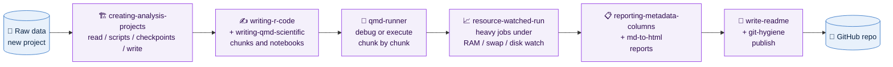

<div align="center">

# 🧠 Agentic Skills for R & Bioinformatics

**Opinionated agent skills that teach Claude Code and Codex how to run single-cell analysis, write R, and document science**


</div>

---

## 📌 At a Glance

| | |
|---|---|
| **What** | **17 skills**: one `SKILL.md` per directory, plus optional `references/`, `assets/` and Codex `agents/openai.yaml` |
| **Why** | Agents follow the same project layout, R style, notebook format and reporting style in every session, without re-explaining |
| **Agents** | **Claude Code** (reads `SKILL.md` frontmatter) and **Codex** (also reads `agents/openai.yaml` for UI metadata) |
| **Domains** | scRNA-seq analysis, R packages, Quarto documents, lab notebooks, job and recommendation letters, git, file naming |
| **Triggering** | The `description` field in each `SKILL.md` frontmatter decides when the agent loads the skill |
| **Style** | Deliberately opinionated: fork it and swap in your own conventions |

---

## 🗺️ How the Skills Fit Together



| Order | Skill | Read it for | Status |
|:---:|---|---|:---:|
| 01 | [`creating-analysis-projects`](creating-analysis-projects/SKILL.md) | The overall project architecture | ✅ |
| 02 | [`writing-r-code`](writing-r-code/SKILL.md) | Code patterns used everywhere | ✅ |
| 03 | [`writing-qmd-scientific`](writing-qmd-scientific/SKILL.md) | How to document analysis pipelines | ✅ |
| 04 | [`naming-conventions`](naming-conventions/SKILL.md) | File naming standards for any project | ✅ |
| 05 | [`developing-r-packages`](developing-r-packages/SKILL.md), [`writing-labarchive-entries`](writing-labarchive-entries/SKILL.md) | Specialised workflows | ✅ |
| 06 | [`tailoring-applications`](tailoring-applications/SKILL.md) | CV and cover letter pipeline | ✅ |
| 07 | [`md-to-html`](md-to-html/SKILL.md) | Finished markdown to polished HTML | ✅ |
| 08 | [`qmd-runner`](qmd-runner/SKILL.md) | Opaque render failures, or executing a notebook for real | ✅ |
| 09 | [`resource-watched-run`](resource-watched-run/SKILL.md) | Any job heavy enough to swap or fill the disk | ✅ |
| 10 | [`reporting-metadata-columns`](reporting-metadata-columns/SKILL.md) | Documenting every metadata column of a Seurat object | ✅ |
| 11 | [`write-readme`](write-readme/SKILL.md) | The front page for any repo you push | ✅ |
| 12 | [`git-hygiene`](git-hygiene/SKILL.md) | Version control conventions for all repos | ✅ |
| 13 | [`agent-report-style`](agent-report-style/SKILL.md) | How the agent proposes changes and reports back | ✅ |
| 14+ | New skills as workflows mature | | 🔜 |

<details>
<summary><b>🔗 Skill dependency graph</b></summary>

```
creating-analysis-projects
├── writing-r-code          (code chunk conventions)
└── writing-qmd-scientific  (document structure)
    └── writing-r-code      (inline code patterns)

writing-labarchive-entries     (standalone — references PubMed MCP)
developing-r-packages          (standalone — R package conventions)
tailoring-applications         (standalone — CV and cover letter pipeline)
md-to-html                     (standalone — converts .md → .qmd → .html via Quarto)
git-hygiene                    (standalone — conventional commit format and branching)
naming-conventions             (standalone — references creating-analysis-projects for project filenames)
qmd-runner                     (pairs with writing-qmd-scientific + writing-r-code; execute mode launches via resource-watched-run)
resource-watched-run           (standalone — pairs with qmd-runner execute mode)
reporting-metadata-columns     (pairs with writing-qmd-scientific + writing-r-code; runs through qmd-runner and resource-watched-run)
write-readme                   (standalone — reads outputs from creating-analysis-projects layouts)
agent-report-style             (standalone — reporting and propose-before-editing style for all tasks)
```

</details>

---

## 🧪 Skills

| Skill | Domain | What it enforces | Extras |
|---|---|---|---|
| 🏗️ [`creating-analysis-projects`](creating-analysis-projects/SKILL.md) | Project setup | Code (git-tracked) strictly separate from data. `read/` → `scripts/` → `checkpoints/` → `write/` layout | `agents/` |
| ✍️ [`writing-r-code`](writing-r-code/SKILL.md) | R coding | Tidyverse-first. Self-contained chunks: `Libraries → Inputs → Processing → Outputs`. Seurat v5 layers. Mandatory Context7 lookups | `agents/` |
| 📓 [`writing-qmd-scientific`](writing-qmd-scientific/SKILL.md) | Quarto documents | Bullet points only, no paragraphs. Hashpipe (`#\|`) chunk options. Parameter justification table after every code block | `agents/` |
| 🔬 [`writing-labarchive-entries`](writing-labarchive-entries/SKILL.md) | Lab notebooks | Numbered, verbose records. Four entry types: datasets, pipelines, tool evaluations, educational notes. PubMed citations | `agents/` |
| 📦 [`developing-r-packages`](developing-r-packages/SKILL.md) | R packages | Full lifecycle after Wickham & Bryan: roxygen2, testthat, semantic versioning, GitHub Actions, pkgdown | `agents/` |
| 💼 [`tailoring-applications`](tailoring-applications/SKILL.md) | Job applications | Parses adverts (text, URL, PDF), scaffolds application directories, drafts cover letters and tailored CVs, renders PDF, drafts PI outreach emails | `agents/` |
| ✉️ [`recommendation-letter-workflow`](recommendation-letter-workflow/SKILL.md) | Academic applications | Quarto letters rendered to PDF. 5-section structure, concrete example per section, superlative caps, 2-page maximum | `agents/`, `references/` |
| 🌗 [`md-to-html`](md-to-html/SKILL.md) | Document conversion | Wraps `.md` in a `.qmd` with darkly theme and cosmo toggle, TOC, embedded resources. Conversion only, no restructuring | `agents/` |
| 📝 [`md-format`](md-format/SKILL.md) | Writing | Blank line before every bullet list so pandoc does not collapse items. Includes verification `grep` commands | |
| 🌐 [`hugo-blog`](hugo-blog/SKILL.md) | Publishing | Dual-file `.rmd` / `.md` posts, hugodown rendering, front matter, README sync before every push | |
| 🏷️ [`naming-conventions`](naming-conventions/SKILL.md) | File organisation | kebab-case, ISO 8601 dates, zero-padded numbering so lexicographic sort matches logical order | |
| 🐞 [`qmd-runner`](qmd-runner/SKILL.md) | Debugging | Debug mode: one `tryCatch` per chunk, all failures in one pass, fixes land in the `.qmd`. Execute mode: fail-fast with `--from <label>` resume | `agents/` |
| 📈 [`resource-watched-run`](resource-watched-run/SKILL.md) | Operations | Pre-flight RAM and disk check, launch under `nice` and `/usr/bin/time`, monitor RSS / swap / disk, kill on threshold, report peak RSS and wall time | `agents/` |
| 📋 [`reporting-metadata-columns`](reporting-metadata-columns/SKILL.md) | Documentation | Lettered Quarto notebook documenting every per-cell metadata column, provider vs analyst. Colour-coded cards, registry CSV, checks for undocumented and missing columns | `agents/`, `references/`, `assets/` |
| 📄 [`write-readme`](write-readme/SKILL.md) | Documentation | This README's structure: badges, At a Glance, Mermaid pipeline, real-number tables, design decisions, figure previews, annotated tree | `agents/` |
| 🔀 [`git-hygiene`](git-hygiene/SKILL.md) | Version control | Conventional Commits with scopes, lowercase subjects, atomic commits, branching conventions | |
| 💬 [`agent-report-style`](agent-report-style/SKILL.md) | Communication | Propose changes as one-line "what — why" items and wait for approval. Report finished work in 1 to 3 lines | `agents/` |

---

## 🔑 Key Design Decisions

> [!IMPORTANT]
> **Every skill needs a symlink one level above the repo.** Agents discover skills at `~/.claude/skills/<name>/SKILL.md` and `~/.codex/skills/<name>/SKILL.md`. This repo lives in `personal_skills/`, so a skill without a symlink is never loaded.

| Decision | Rationale |
|---|---|
| 🔢 **Numbered headings in lab entries, none in notebooks** | Quarto's TOC handles notebook navigation. LabArchive entries are standalone records and need explicit section numbers |
| • **Bullet points only in `.qmd` prose** | A deliberate readability choice for analysis notebooks, not a rule for every skill |
| 🧩 **Self-contained code chunks** | Each chunk loads its own checkpoint instead of relying on in-memory state, so any chunk runs and debugs in isolation |
| 🔍 **Context7 lookup before package calls** | `writing-r-code` lists 14 API-sensitive packages (Seurat, SeuratDisk, scater, harmony and others). Verify signatures first, write second |
| 🎨 **BadranSeq first for plots** | Fallback chain BadranSeq → SCpubr → Seurat keeps single-cell figures consistent across projects |
| 🌙 **HTML output is dark by default** | Every HTML-rendering skill uses `theme: {dark: darkly, light: cosmo}` with dark listed first. Never a light-only theme |
| 🤖 **`agents/openai.yaml` is Codex-only** | Holds `display_name`, `short_description` and `default_prompt` for Codex. Claude Code ignores `agents/`, so both tools share one tree |

---

## 🖼️ Skill Anatomy

Each skill is a directory whose `SKILL.md` frontmatter tells the agent when to load it.

```yaml
---
name: qmd-runner
description: Use when debugging Quarto (`.qmd`) notebooks chunk-by-chunk via
  auto-generated tryCatch runners. Triggers when a `quarto render` fails opaquely, ...
---
```

```
reporting-metadata-columns/
├── SKILL.md                              # rules and workflow, loaded by the agent
├── agents/openai.yaml                    # Codex display metadata
├── references/render-metadata-cards.R    # helper code the skill points to
└── assets/metadata-columns-template.qmd  # template copied into a project
```

---

## 📁 Repository Layout

```
personal_skills/
├── 📄 README.md
├── 🧭 CLAUDE.md                     # guidance for Claude Code working in this repo
├── 🧭 CODEX.md                      # guidance for Codex working in this repo
├── ⚙️ .gitignore                    # editor swap files, .DS_Store, docs/
├── 🏗️ creating-analysis-projects/
├── ✍️ writing-r-code/
├── 📓 writing-qmd-scientific/
├── ...                              # one directory per skill (17 total)
└── 💬 agent-report-style/

    ── not tracked (local only) ──────────────────────────
~/.claude/skills/<skill-name>        # symlink → personal_skills/<skill-name>
~/.codex/skills/<skill-name>         # symlink → personal_skills/<skill-name>
```

> [!NOTE]
> The symlinks that make skills discoverable live **outside** the repo and are never committed. Recreate them after every clone (see below).

---

## 🚀 Installing

```bash
# 1. Clone into each agent's skills directory
git clone https://github.com/wolf5996/agentic-skills.git ~/.claude/skills/personal_skills
git clone https://github.com/wolf5996/agentic-skills.git ~/.codex/skills/personal_skills

# 2. Symlink every skill one level up so the agent can discover it
cd ~/.claude/skills
for s in personal_skills/*/SKILL.md; do d=$(dirname "$s"); ln -sfn "$d" "$(basename "$d")"; done
cd ~/.codex/skills
for s in personal_skills/*/SKILL.md; do d=$(dirname "$s"); ln -sfn "$d" "$(basename "$d")"; done

# 3. Or cherry-pick a single skill
git clone https://github.com/wolf5996/agentic-skills.git /tmp/agentic-skills
cp -r /tmp/agentic-skills/writing-r-code ~/.claude/skills/
rm -rf /tmp/agentic-skills
```

Both clones push to the same remote, so skill content stays in sync through `git pull`.

<details>
<summary><b>🍴 Fork and customise</b></summary>

1. **Fork** this repository on GitHub
2. **Swap the author name**: search for `Badran Elshenawy` in YAML templates and replace it
3. **Swap preferred packages**: replace `BadranSeq` in `writing-r-code` with your own (e.g. `SCpubr`, `dittoSeq`, base `Seurat`)
4. **Adjust project paths**: adapt the `read/scripts/checkpoints/write/` layout in `creating-analysis-projects`
5. **Adjust the Context7 list**: add or remove packages in `writing-r-code` to match your stack

</details>

---

## 📦 Dependencies

| Area | Packages |
|---|---|
| 🤖 Agents | [Claude Code](https://docs.anthropic.com/en/docs/claude-code), Codex |
| 🔌 MCP servers | [Context7](https://github.com/upstash/context7) (`writing-r-code`), PubMed (`writing-labarchive-entries`, `developing-r-packages`, `tailoring-applications`) |
| 🧬 Single-cell R | `Seurat`, `SeuratObject`, `tidyseurat`, `scater`, `biomaRt` |
| 🎨 Visualisation | [`BadranSeq`](https://github.com/wolf5996/BadranSeq) ([site](https://wolf5996.github.io/BadranSeq/)), `ggplot2`, `patchwork` |
| 🧹 Tidyverse | `dplyr`, `readr`, `purrr`, `tidyr`, `tibble`, `stringr`, `conflicted` |
| 📄 Documents | `quarto`, `knitr`, `htmltools`, `pdftoppm`, `magick` |

---

## ✍️ Code Conventions

<details>
<summary>Rules for adding or editing a skill</summary>

- **Directory name**: lowercase, hyphen-separated, matching the frontmatter `name` (e.g. `writing-r-code`)
- **Frontmatter**: `name` and `description`; the description names the file types, tasks and contexts that should trigger the skill
- **Codex metadata**: optional `agents/openai.yaml`; regenerate it when the human-facing description changes
- **Symlinks**: create `ln -s personal_skills/<skill-name> <skill-name>` in both `~/.claude/skills/` and `~/.codex/skills/` before committing
- **Invocation**: agents load skills with the `Skill` tool, never by reading `SKILL.md`
- **Shared conventions**: after changing `writing-r-code`, check `writing-qmd-scientific` and `creating-analysis-projects`
- **This README**: add every new skill to the Skills table, the reading order and the dependency graph
- **Commits**: follow `git-hygiene` (Conventional Commits, scoped, lowercase)

</details>

---

<div align="center">

**Badran Elshenawy** · Nuffield Department of Medicine · University of Oxford

MIT licence: fork, adapt, and share freely.

</div>
